# UI Screenshots

These screenshots show the current settings page and Composer controls for DSH `v0.1.3-alpha.2`.
The image files live in [`docs/assets/screenshots/`](./assets/screenshots/) so GitHub renders them through stable raw URLs after the branch is merged.

## Plugin page and per-model compaction

Captured on a live DSH `0.2.2-rc.1` Web instance whose `llm-pi-ai` route declares
one `sub2api` provider with 15 models, so the per-model surface is shown against
a real catalog rather than a fixture.

| Plugin icon on the Plugins page | Per-model effort levels and compaction thresholds |
| --- | --- |
|  | [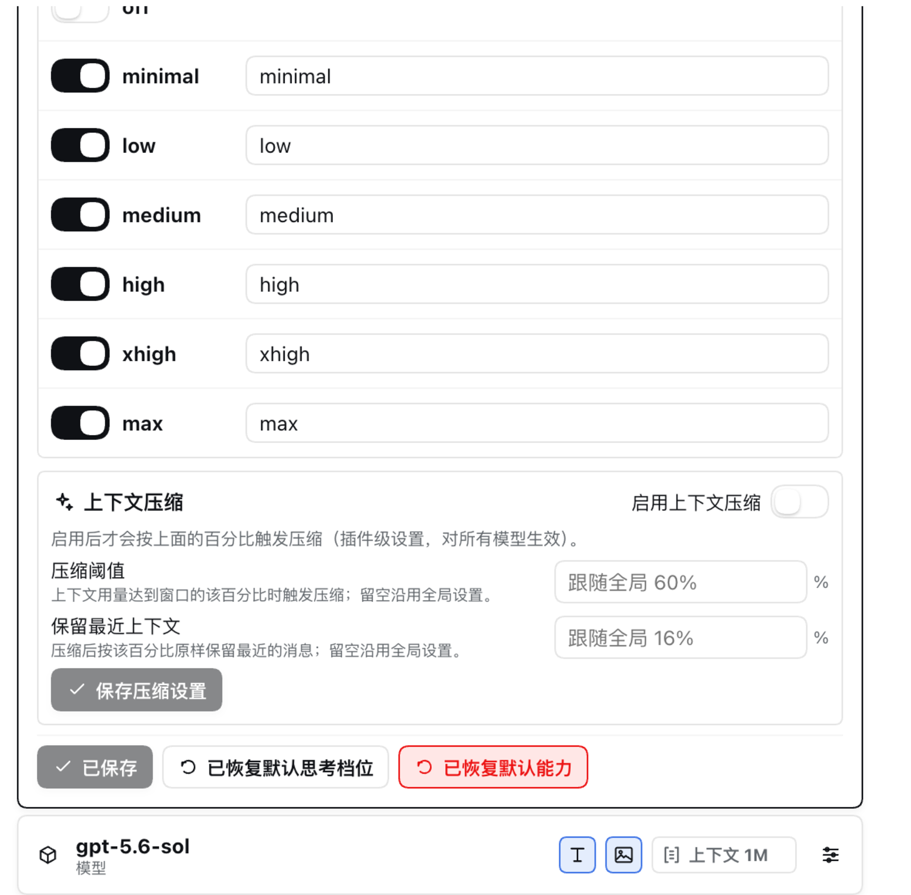](https://raw.githubusercontent.com/hytime/dsh-thinking-effort/main/docs/assets/screenshots/plugin-zh-compaction-thresholds.png) |

The icon is the manifest `icon` this package declares, rendered by the Plugin
Manager as a data URL. The second image is the editor for one `sub2api` model:
its effort levels with their wire values, and the **Context compaction** card
whose empty fields follow the global 60% trigger and 16% retained ratio.

## Chinese

| Settings overview | Expanded settings | Composer reasoning | Model search |
| --- | --- | --- | --- |
| [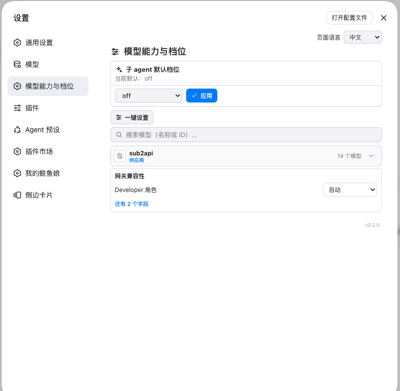](https://raw.githubusercontent.com/hytime/dsh-thinking-effort/main/docs/assets/screenshots/plugin-zh-settings-overview.png) | [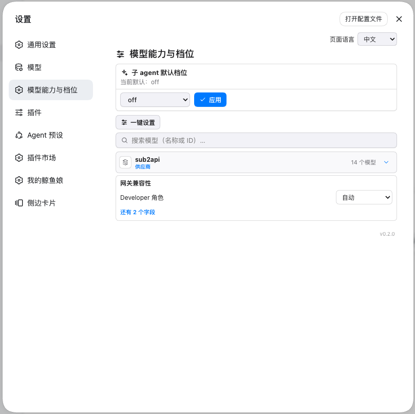](https://raw.githubusercontent.com/hytime/dsh-thinking-effort/main/docs/assets/screenshots/plugin-zh-settings-expanded.png) | [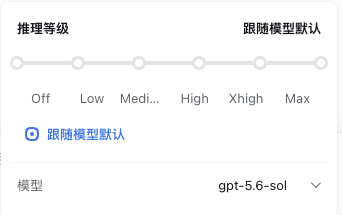](https://raw.githubusercontent.com/hytime/dsh-thinking-effort/main/docs/assets/screenshots/plugin-zh-composer-reasoning.png) | [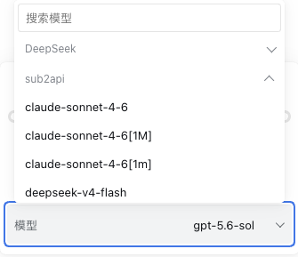](https://raw.githubusercontent.com/hytime/dsh-thinking-effort/main/docs/assets/screenshots/plugin-zh-composer-model-search.png) |

## English

| Settings overview | Expanded settings | Composer reasoning | Model search |
| --- | --- | --- | --- |
| [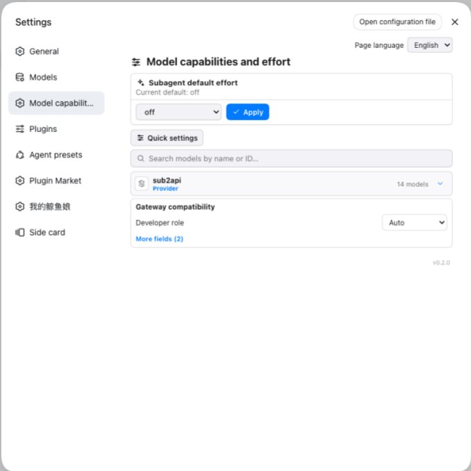](https://raw.githubusercontent.com/hytime/dsh-thinking-effort/main/docs/assets/screenshots/plugin-en-settings-overview.png) | [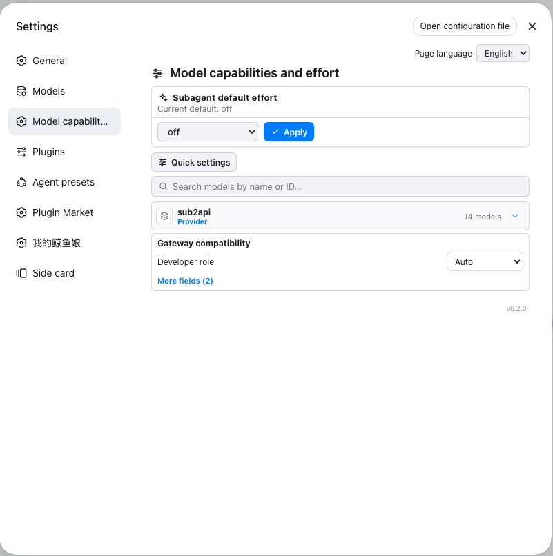](https://raw.githubusercontent.com/hytime/dsh-thinking-effort/main/docs/assets/screenshots/plugin-en-settings-expanded.png) | [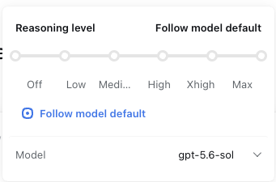](https://raw.githubusercontent.com/hytime/dsh-thinking-effort/main/docs/assets/screenshots/plugin-en-composer-reasoning.png) | [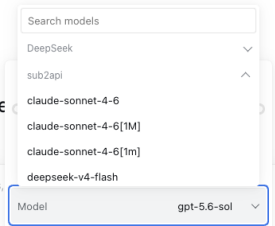](https://raw.githubusercontent.com/hytime/dsh-thinking-effort/main/docs/assets/screenshots/plugin-en-composer-model-search.png) |

## 日本語

| 設定概要 | 展開した設定 | Composer 推論 | モデル検索 |
| --- | --- | --- | --- |
| [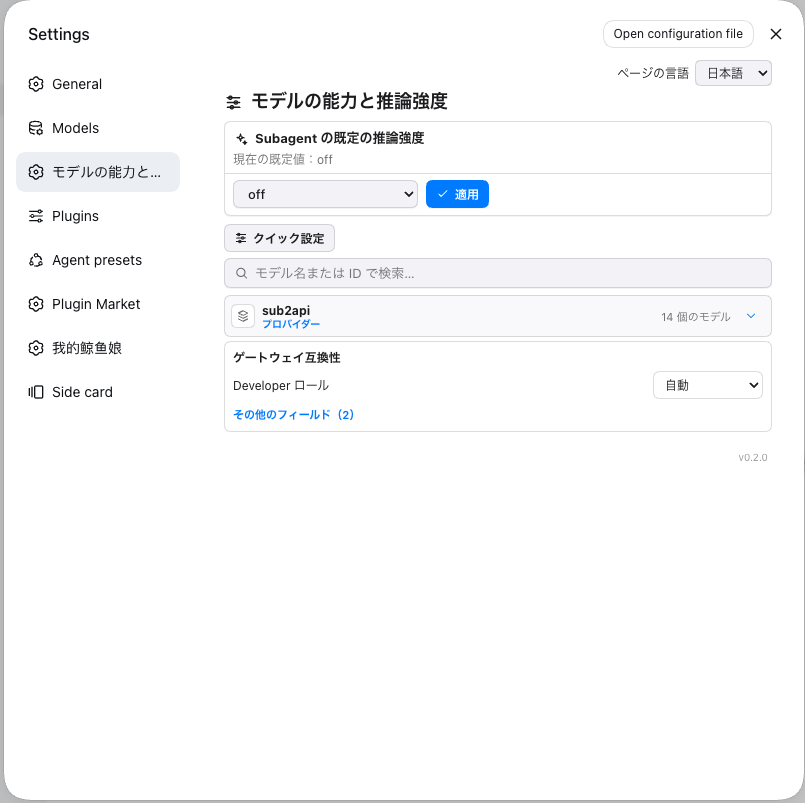](https://raw.githubusercontent.com/hytime/dsh-thinking-effort/main/docs/assets/screenshots/plugin-ja-settings-overview.png) | [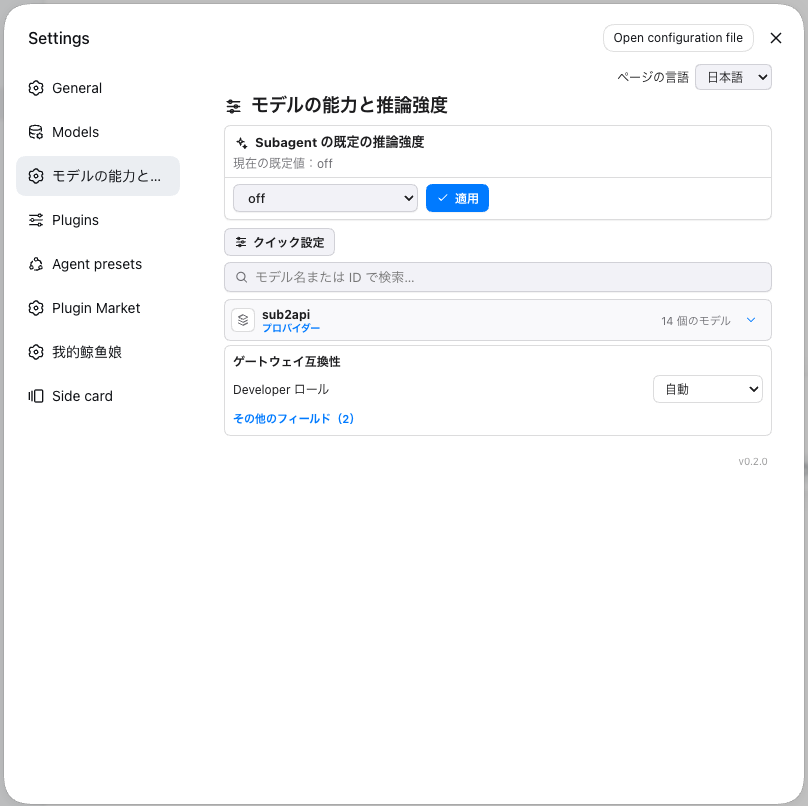](https://raw.githubusercontent.com/hytime/dsh-thinking-effort/main/docs/assets/screenshots/plugin-ja-settings-expanded.png) | [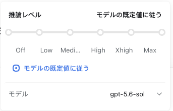](https://raw.githubusercontent.com/hytime/dsh-thinking-effort/main/docs/assets/screenshots/plugin-ja-composer-reasoning.png) | [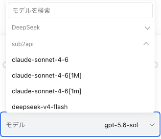](https://raw.githubusercontent.com/hytime/dsh-thinking-effort/main/docs/assets/screenshots/plugin-ja-composer-model-search.png) |

## 한국어

| 설정 개요 | 펼친 설정 | Composer 추론 | 모델 검색 |
| --- | --- | --- | --- |
| [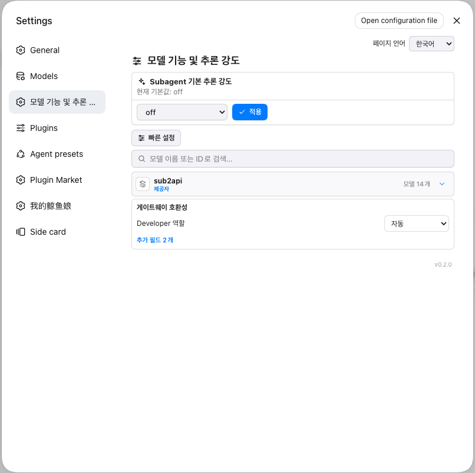](https://raw.githubusercontent.com/hytime/dsh-thinking-effort/main/docs/assets/screenshots/plugin-ko-settings-overview.png) | [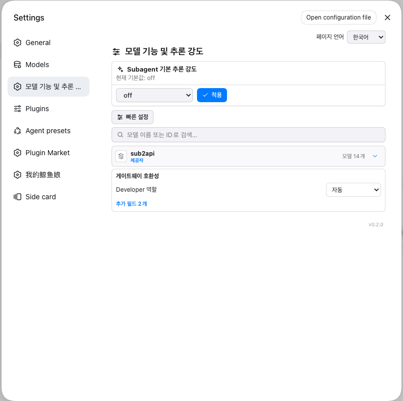](https://raw.githubusercontent.com/hytime/dsh-thinking-effort/main/docs/assets/screenshots/plugin-ko-settings-expanded.png) | [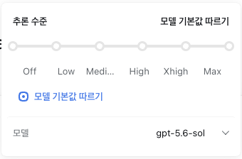](https://raw.githubusercontent.com/hytime/dsh-thinking-effort/main/docs/assets/screenshots/plugin-ko-composer-reasoning.png) | [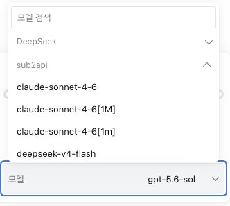](https://raw.githubusercontent.com/hytime/dsh-thinking-effort/main/docs/assets/screenshots/plugin-ko-composer-model-search.png) |
